# CyberStock Pulse

賽博朋克風格的跨平台實時多市場（美股 / 港股）股票終端。支援 Web（桌面 / 手機 / PWA）、iOS、Android，以及繁體中文（香港 / 台灣）、簡體中文、英文。

> 本文件整合了**快速開始、程式規格（功能規格）、技術規格與所有圖表**。開發規範見 [AGENT.MD](AGENT.MD)。
> **數據來源：** 行情及新聞預設都來自 Yahoo Finance（真實數據、免 API key；非官方端點、只限個人使用、港股報價約延遲 15 分鐘）。詳見 [§5.4](#54-行情數據供應商) 及 [§5.5](#55-新聞供應商)。所有內容僅供參考，不構成投資建議。

## 目錄

1. [快速開始](#1-快速開始)
2. [系統概覽](#2-系統概覽)
3. [程式規格（功能規格）](#3-程式規格功能規格)
4. [業務規則](#4-業務規則)
5. [技術規格：架構與元件](#5-技術規格架構與元件)
6. [主要流程（時序圖）](#6-主要流程時序圖)
7. [API 規格](#7-api-規格)
8. [資料模型](#8-資料模型)
9. [安全與機密管理](#9-安全與機密管理)
10. [部署（Docker + HTTPS + Caddy）](#10-部署docker--https--caddy)
11. [建置、測試與手機 App](#11-建置測試與手機-app)
12. [設定（環境變數）](#12-設定環境變數)
13. [實作狀態與已知限制](#13-實作狀態與已知限制)
14. [變更紀錄](#14-變更紀錄)

---

## 1. 快速開始

前置需求：Docker（OrbStack / Docker Desktop）、Node.js 24+、Java 21+、Maven、Python 3.11+、openssl。

```bash
./scripts/secrets.sh init                 # 建立加密 .env（自動產生資料庫密碼與 JWT 密鑰）
./scripts/secrets.sh set DEEPSEEK_API_KEY # 選填：輸入時不顯示，加密寫入 .env
./scripts/build.sh                        # 前端 + 後端 + AI 測試，並建置 Docker 映像
./scripts/deploy.sh up                    # 移除舊容器 → 啟動 → 等待健康 → HTTPS smoke test
```

開啟 <https://localhost:60003>（自簽憑證，瀏覽器會警告一次）。公開網址設定見 [§10.3](#103-公開-https共用-caddy)。

- `deploy.sh up` 每次都會**先移除已存在的 CyberStock 容器**再啟動（資料 volume 保留），詳見 [§10.2](#102-部署流程)。
- 行情及新聞預設使用 Yahoo Finance，**不需要任何 API key**；`FINNHUB_API_KEY` 可留空。
- 只有 AI 功能（新聞情緒 / 摘要、AI 分析師）需要 `DEEPSEEK_API_KEY`，設定步驟見 [§9.2](#92-設定-api-key逐步說明)。

| 指令 | 用途 |
|------|------|
| `./scripts/deploy.sh up [--no-build]` | 移除已存在的容器 → 建置 → 啟動 → 等待健康 → smoke test |
| `./scripts/deploy.sh down` | 停止並移除容器（保留資料 volume） |
| `./scripts/deploy.sh status` / `logs [svc]` / `smoke` | 狀態 / 日誌 / 測試 |
| `./scripts/build.sh frontend\|backend\|ai\|images` | 只建置單一元件 |
| `./scripts/build.sh mobile https://<公開網址>` | 建置手機 App 用前端並 `cap sync` |
| `./scripts/secrets.sh set KEY` / `check` | 設定加密值 / 檢查 `.env` 已全部加密 |
| `./scripts/generate-cert.sh` | 產生自簽 TLS 憑證到 `certs/` |

本機開發（不經 Docker 跑前端）：

```bash
cd backend && mvn spring-boot:run          # :8080，需要 PostgreSQL（DATABASE_URL 等）
cd analytics-ai && .venv/bin/uvicorn app.main:create_app --factory --port 8000
cd frontend && npm run dev                 # :5173，代理 /api /ws /ai 到上面兩個服務
```

---

## 2. 系統概覽

### 2.1 目的與範圍

給個人投資者使用的美股及港股實時行情與投研終端：

- 實時報價、熱門股霓虹走馬燈、K 線圖、公司 Logo
- 財經新聞串流，附 DeepSeek 情緒標記與四語摘要
- 個人投資組合帳本與損益計算
- DeepSeek 驅動的 AI 分析師（唯讀工具，不能下單）

**不在範圍內：** 下單交易、券商帳戶連接、投資建議。

### 2.2 系統架構圖

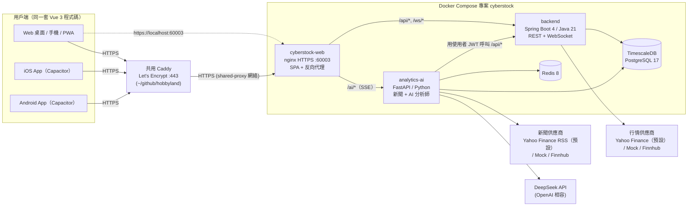

### 2.3 使用者與權限

| 角色 | 可用功能 |
|------|----------|
| 訪客（未登入） | 行情、走馬燈、K 線、搜尋、新聞、設定。自選股只存在本機 |
| 已登入使用者 | 以上全部 + 投資組合、AI 分析師；自選股、語言、升跌顏色跨裝置同步 |

每位使用者只能讀寫自己的投資組合與自選股：後端所有查詢都以 JWT `sub`（使用者 ID）為條件。AI 分析師以**使用者自己的 JWT** 呼叫後端，權限不會超過使用者本身。

### 2.4 支援平台與語言

| 項目 | 規格 |
|------|------|
| Web 桌面 | Chrome / Edge / Safari / Firefox 最新兩個主版本 |
| Web 手機 | iOS Safari、Android Chrome，可安裝為 PWA |
| 原生 App | iOS（iPhone / iPad）、Android（手機 / 平板），Capacitor 8 打包同一份 `dist/` |
| 語言 | `zh-HK` 繁體（香港）、`zh-TW` 繁體（台灣）、`zh-CN` 簡體、`en-US` 英文 |

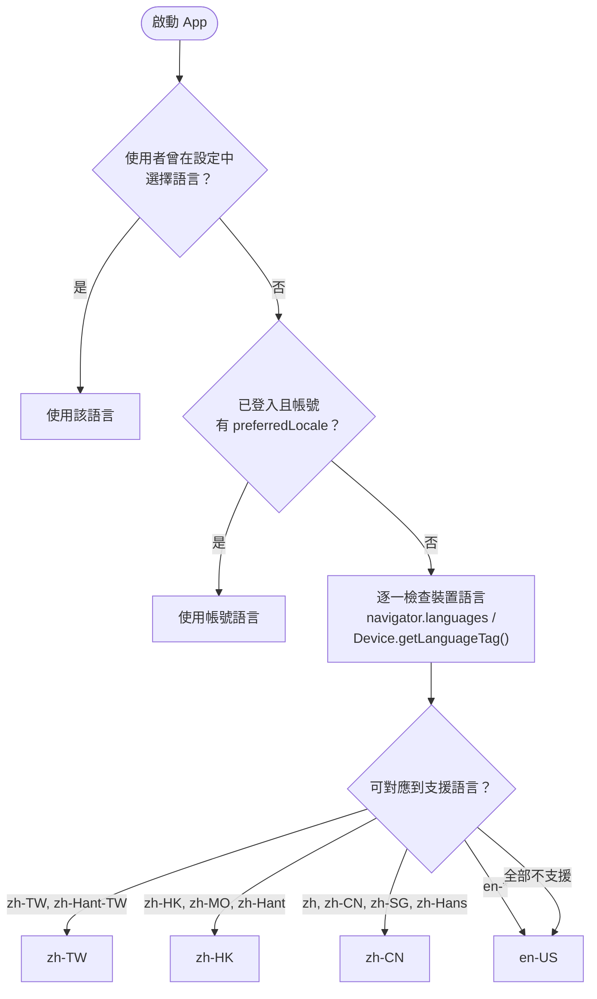

- 缺字回退：`zh-HK → zh-TW → en-US`，其他語言 → `en-US`。
- 切換語言即時生效，不需重新整理；公司名稱、新聞摘要、AI 回覆、錯誤訊息都跟隨語言。
- 金融用語按地區翻譯：港「沽出 / 派息 / 孖展 / 窩輪」、台「賣出 / 配息 / 融資 / 權證」、陸「卖出 / 分红 / 融资 / 权证」。
- 四份語系檔（138 個 key）由 `npm run i18n:check` 檢查 key、空值及 `{placeholder}` 一致；單元測試另檢查原始碼用到的每個 `t('…')` key 都存在。

---

## 3. 程式規格（功能規格）

### 3.1 畫面導覽圖

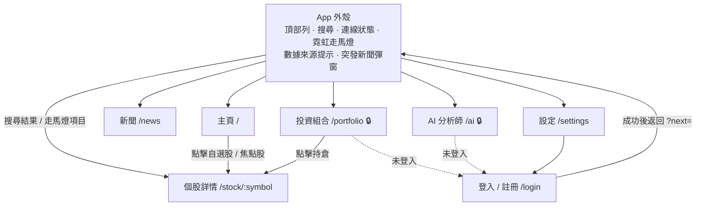

🔒 = 需要登入。桌面（≥1024px）用頂部導覽；手機與直向平板用底部分頁列，並適配瀏海與底部安全區域。

### 3.2 功能清單

| 編號 | 功能 | 畫面 | 說明 |
|------|------|------|------|
| F-01 | 霓虹走馬燈 | 全域 | 無限捲動 `is_marquee` 股票（Logo、代號、現價、升跌幅）；懸停 / 聚焦暫停；點擊進入個股；「減少動態效果」時改為手動捲動 |
| F-02 | 數據來源提示 | 全域 | `mock` 顯示黃色「模擬數據」；`yahoo` 顯示「報價來自 Yahoo Finance，可能有延遲（港股約 15 分鐘）」 |
| F-03 | 連線狀態 | 全域 | 實時 / 連線中 / 重新連線中 / 離線 |
| F-04 | 搜尋 | 全域 | 代號、英文、繁體、簡體名皆可搜尋（例如繁體介面輸入「腾讯」找到 0700.HK）；200ms 防抖、最多 20 筆、鍵盤操作 |
| F-05 | 市場狀態 | 主頁 | NASDAQ / NYSE / HKEX 交易時段，每 60 秒更新 |
| F-06 | 自選股 | 主頁、個股 | Logo、代號、簡稱、成交量、現價、升跌；價格變動閃爍；訪客存本機，登入後同步帳號 |
| F-07 | K 線圖 | 主頁、個股 | `1m 5m 15m 1h 4h 1d 1w 1M`；成交量柱、MA20；最新一根隨實時報價更新；Yahoo 模式為真實歷史數據 |
| F-08 | 個股詳情 | 個股 | 現價、升跌、報價時間（交易所時區）、開市 / 最高 / 最低 / 前收市 / 成交量、相關新聞、加入自選 |
| F-09 | 新聞串流 | 新聞、主頁 | 突發標記、情緒標籤（利好 / 利淡 / 中性 / 未分析 + 分數）、AI 摘要、原文連結；按情緒篩選；SSE 即時加入 |
| F-10 | 突發新聞彈窗 | 全域 | 最多 3 則，可關閉；原生 App 震動 |
| F-11 | 投資組合 | 投資組合 | 新增買入 / 沽出 / 派息、持倉表、每種貨幣總覽、交易紀錄（可刪除） |
| F-12 | AI 分析師 | AI 分析師 | DeepSeek 串流回答、顯示正在使用的工具、可停止、免責聲明 |
| F-13 | 設定 | 設定 | 語言、升跌顏色、戶外高對比、震動回饋、帳戶、版本 |
| F-14 | 登入 / 註冊 | 登入 | 電郵 + 密碼（8–128 字元）；錯誤訊息不透露帳號是否存在 |
| F-15 | 開頁動畫 | 全域 | 3D 旋轉霓虹立方體、品牌字 glitch、K 線自動繪出、漸變載入條；最少 1.7 秒、數據載入完成即離開、最多 4.5 秒；點擊 / Enter / Esc 可跳過（`SplashScreen.vue`） |
| F-16 | 漸變與 3D 視覺 | 全域 | 流動極光背景、3D 透視霓虹網格地板、自轉線框立方體（`CyberBackdrop.vue`）；漸變霓虹邊框面板、漸變標題及按鈕；指標卡滑鼠 3D 傾斜 + 反光（`v-tilt`）；轉頁 3D 過場；3D 立方體 Logo |

> 視覺效果只動畫 `transform` / `opacity`（GPU 合成，手機流暢）；數字及正文保持實色。觸控裝置不啟用傾斜效果；「減少動態效果」及「戶外高對比模式」會關閉全部動畫及 3D 效果。

### 3.3 錯誤代碼

後端只回傳 `{ "code": "...", "params": {...} }`（AI 服務為 `{ "detail": { "code": "..." } }`），前端按語言翻譯。

| 代碼 | 意思 |
|------|------|
| `INVALID_CREDENTIALS` | 電郵或密碼不正確 |
| `EMAIL_ALREADY_REGISTERED` | 電郵已註冊 |
| `VALIDATION_FAILED` | 欄位驗證失敗（`params` 列出欄位） |
| `INSUFFICIENT_POSITION` | 持股不足以沽出（`params.symbol`） |
| `INSTRUMENT_NOT_FOUND` | 股票不存在 |
| `TRANSACTION_NOT_FOUND` | 交易不存在或不屬於該使用者 |
| `TRANSACTION_IN_FUTURE` / `INVALID_TRANSACTION` | 交易日期在未來 / 數值無效 |
| `INVALID_INTERVAL` | 不支援的 K 線週期 |
| `UNSUPPORTED_LOCALE` / `INVALID_COLOR_SCHEME` | 偏好設定值無效 |
| `UNAUTHORIZED` / `USER_NOT_FOUND` | 需要重新登入 |
| `RATE_LIMITED` | 請求過於頻密 |
| `LLM_NOT_CONFIGURED` / `LLM_UNAVAILABLE` | 未設定 DeepSeek key / AI 暫時不可用 |
| `TOO_MANY_TOOL_CALLS` / `INVALID_CHAT_REQUEST` | 問題過於複雜 / 對話內容無效 |
| `AUTH_NOT_CONFIGURED` | AI 服務未設定 JWT 密鑰 |
| `BAD_REQUEST` / `INTERNAL_ERROR` / `NETWORK` | 一般錯誤（`NETWORK` 只在前端產生） |

### 3.4 非功能需求

| 類別 | 要求 |
|------|------|
| 可讀性 | 文字與數字對比度 ≥ WCAG AA 4.5:1；數字用等寬 `tabular-nums`；戶外高對比模式移除發光及透明 |
| 無障礙 | 觸控目標 ≥ 44px；全鍵盤操作；「跳至主要內容」；`aria-live` 通知；支援 `prefers-reduced-motion` |
| 效能 | 報價每 500ms 批次重繪；非英文語系檔延遲載入；PWA 只快取靜態檔，不快取 `/api` `/ws` `/ai` |
| 安全 | 全站 HTTPS；金鑰只在後端；`.env` 加密（[§9](#9-安全與機密管理)） |
| 合規 | AI 內容附免責聲明；模擬 / 延遲數據有明顯標示；Yahoo 數據只限個人使用 |

---

## 4. 業務規則

### 4.1 金額精度

- 價格、股數、金額全程十進位運算：後端 `BigDecimal`、前端 `decimal.js`、AI 服務 `Decimal`。API 以**字串**傳送（例如 `"134.300"`）。
- 資料庫：金額及股數 `NUMERIC(18,6)`、成交量 `NUMERIC(20,2)`、情緒分數 `NUMERIC(3,2)`。
- Yahoo 價格按其 `priceHint` 保留小數（美股 2 位、港股 3 位，限制在 2–4 位），把 float32 誤差（如 `141.39999389648438`）還原為交易所價格 `141.400`。
- 輸入：非負、最多 12 位整數及 6 位小數；股數必須 > 0。
- 顯示四捨五入（half-up）；內部計算銀行家捨入（half-even）。

### 4.2 損益計算（平均成本法）

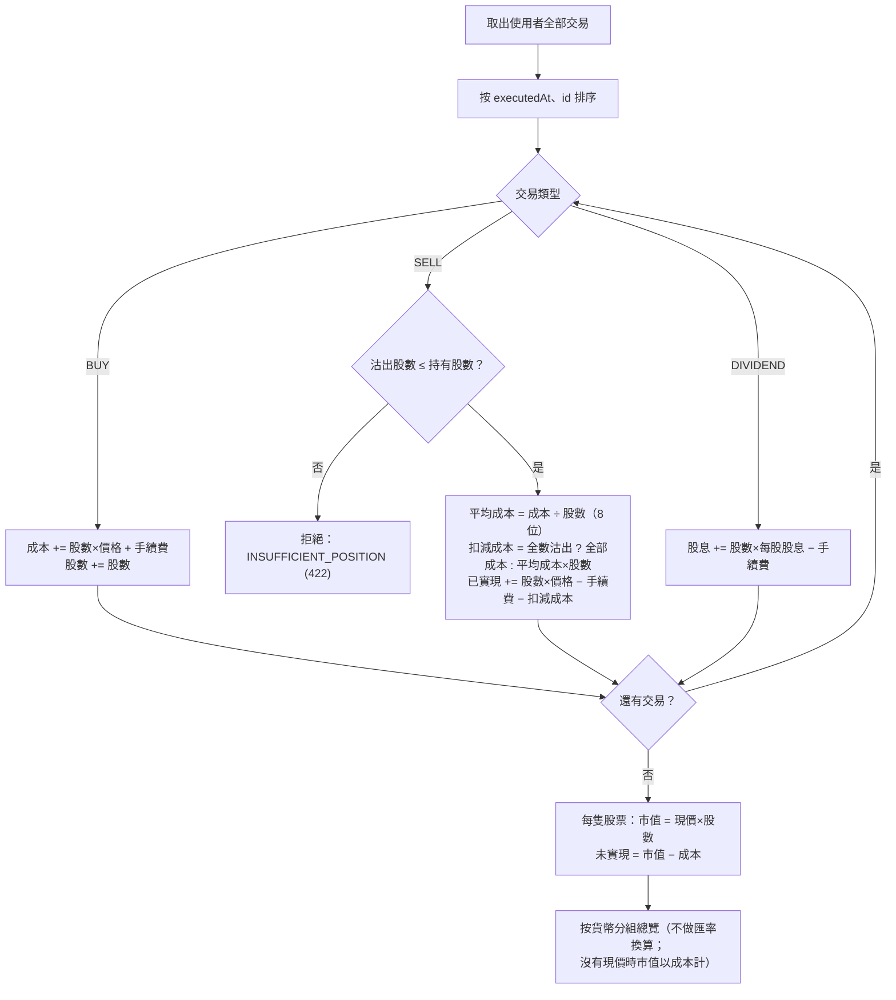

- 新增及刪除交易都會重算整條帳本；若導致任何時點超賣，操作被拒絕。
- 交易日期不可晚於現在 60 秒以上。

### 4.3 升跌顏色

預設 `zh-CN`、`zh-TW` 紅升綠跌；`zh-HK`、`en-US` 綠升紅跌。使用者可修改，K 線、報價、損益、新聞標籤全部跟隨。

### 4.4 實時行情（前端）

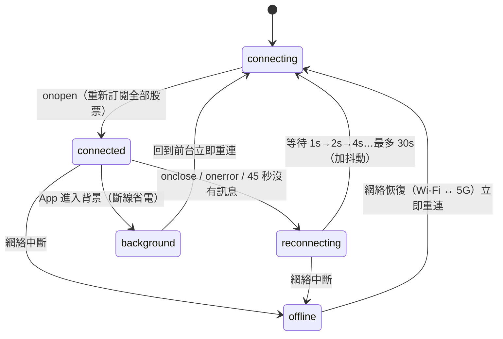

- 每 20 秒發送 `ping`；報價先放入緩衝區，每 500ms 批次寫入 store，同一股票只取最新、舊時間戳丟棄。

### 4.5 交易時段（交易所當地時間，週一至五）

| 交易所 | 盤前 | 交易中 | 午休 | 盤後 |
|--------|------|--------|------|------|
| NASDAQ / NYSE（America/New_York） | 04:00–09:30 | 09:30–16:00 | — | 16:00–20:00 |
| HKEX（Asia/Hong_Kong） | 09:00–09:30 | 09:30–12:00、13:00–16:00 | 12:00–13:00 | 16:00–16:10 |

其他時間及週末為「已收市」；夏令時間由時區資料處理；**未處理公眾假期**。

### 4.6 新聞與 AI 情緒

- 每則新聞（按網址去重，多副本時另用 Redis `SET NX` 鎖）只送 DeepSeek 一次，同時取得分數及英文、簡體摘要；港 / 台繁體由 OpenCC（`s2hk` / `s2twp`）轉換並套用地區用語。
- 分數 −1 至 1（2 位小數）：≥ 0.25 利好、≤ −0.25 利淡、其餘中性；|分數| ≥ 0.70 為突發。
- 沒有 DeepSeek key 或 DeepSeek 失敗：新聞照常顯示，標記「未分析」，摘要用原文。

### 4.7 AI 分析師限制

- 每位使用者每 5 分鐘最多 20 次請求；最多帶入最近 20 則訊息、每則 4000 字元；每題最多 4 輪工具查詢。
- 送出前移除電郵及電話；客戶端送來的 `system` 訊息會被丟棄。
- 工具全部唯讀（報價、K 線、公司資料、自己的持倉、新聞），不能下單；不推薦具體買賣。

---

## 5. 技術規格：架構與元件

### 5.1 技術棧

| 層 | 技術 | 目錄 |
|----|------|------|
| 前端 | Vue 3.5、Vite 8、TypeScript、Pinia、Vue Router、vue-i18n、Tailwind CSS 4、lightweight-charts 5、decimal.js、vite-plugin-pwa | `frontend/` |
| 原生殼 | Capacitor 8（Haptics、Network、App、Preferences、Device、StatusBar） | `frontend/ios/`、`frontend/android/` |
| 核心後端 | Java 21、Spring Boot 4.1（WebMVC、WebSocket、Data JPA、Security + OAuth2 Resource Server、Flyway、Actuator） | `backend/` |
| AI 服務 | Python 3.12、FastAPI、openai SDK（DeepSeek）、OpenCC、psycopg 3、redis、PyJWT、MCP SDK 2 | `analytics-ai/` |
| 資料 | TimescaleDB 2.31（PostgreSQL 17）、Redis 8 | Docker volumes |
| 邊緣 | nginx 1.31（HTTPS :60003）、共用 Caddy 2（Let's Encrypt） | `frontend/nginx.conf`、`deploy/` |

### 5.2 後端模組（`com.cyberstock`）

| 套件 | 主要類別 | 職責 |
|------|----------|------|
| `instrument` | `InstrumentService`、`InstrumentController` | 商品主檔（記憶體快取）、四語名稱、跨繁簡搜尋 |
| `market` | `MarketDataProvider`、`YahooMarketDataProvider`、`MockMarketDataProvider`、`FinnhubMarketDataProvider` | 行情供應商（可替換） |
| `market` | `QuoteService`、`CandleService`、`QuoteWebSocketHandler` | 最新報價、K 線（懶載入 + 實時合併）、`/ws/quotes` 廣播 |
| `market` | `MarketSessionService`、`Interval` | 交易時段、K 線分桶（日線以上按交易所當地日曆） |
| `auth` | `AuthController`、`UserController`、`JwtService` | 註冊、登入（BCrypt 12）、HS256 JWT、偏好設定 |
| `portfolio` | `PortfolioCalculator`、`PortfolioService` | 平均成本法損益（純函數）、帳本 CRUD |
| `watchlist` | `WatchlistController` | 自選股同步 |
| `config` / `common` | `SecurityConfig`、`WebSocketConfig`、`GlobalExceptionHandler`、`Locales` | 安全、CORS、錯誤代碼、`Accept-Language` 解析 |

### 5.3 AI 服務模組（`analytics-ai/app`）

| 模組 | 職責 |
|------|------|
| `llm/provider.py` | `OpenAICompatibleProvider`（DeepSeek）+ `FallbackLLM`：DeepSeek 失敗才用備用供應商 |
| `analysis.py` | 一次呼叫取得情緒分數 + 英文 / 簡體摘要，轉成四語 |
| `news/` | 供應商（mock / finnhub）、儲存（記憶體 / PostgreSQL）、擷取迴圈與 SSE 發佈 |
| `chat/` | AI 分析師工具迴圈、唯讀工具（以使用者 JWT 呼叫後端） |
| `mcp_server.py` | 以 stdio 提供同一組唯讀工具給 MCP 用戶端 |
| `auth.py`、`privacy.py`、`i18n.py` | JWT 驗證、移除 PII 及遮罩金鑰、語言對應與繁簡轉換 |

### 5.4 行情數據供應商

以 `MARKET_DATA_PROVIDER` 選擇（Docker 預設 `yahoo`，`application.yml` 預設 `mock` 供測試使用）。

| 供應商 | API key | 美股 | 港股 | 更新方式 | K 線歷史 | 限制 |
|--------|---------|------|------|----------|----------|------|
| `yahoo`（預設） | 不需要 | ✅ | ✅（約延遲 15 分鐘） | 每 `YAHOO_POLL_SECONDS`（15 秒）輪詢一次，每隻股票 1 個請求（13 隻 ≈ 52 次 / 分鐘） | ✅ 真實歷史 | 非官方端點，可能無預警改變或限流；Yahoo 條款只允許個人使用 |
| `mock` | 不需要 | 模擬 | 模擬 | 每 250ms 隨機漫步 | 合成歷史 | 價格不真實；重啟後回到固定起始價 |
| `finnhub` | `FINNHUB_API_KEY` | ✅ | 免費方案通常不支援 | 每 `FINNHUB_POLL_SECONDS`（15 秒）輪詢 | 合成歷史 | 免費方案 60 次 / 分鐘 |

Yahoo 端點：`https://query1.finance.yahoo.com/v8/finance/chart/<symbol>`（請求帶 `User-Agent`）。

| 欄位 | Yahoo 來源 |
|------|------------|
| 現價 / 前收市 | `meta.regularMarketPrice` / `meta.chartPreviousClose` |
| 開市 | `indicators.quote[0].open[0]` |
| 最高 / 最低 / 成交量 | `meta.regularMarketDayHigh` / `regularMarketDayLow` / `regularMarketVolume` |
| 報價時間 | `meta.regularMarketTime`（秒 → 毫秒） |

- 只在價格、時間或成交量改變時才推送，避免無意義的 UI 更新。
- K 線週期對應：`1m`→Yahoo `1m`/5 天、`5m 15m 30m`→同名/1 個月、`1h`→`60m`/6 個月、`4h`→`60m`/1 年再合併、`1d`→`1d`/2 年、`1w`→`1wk`/10 年、`1M`→`1mo`/全部。所有 Yahoo 柱都重新分桶到 app 的週期（日線以上用交易所當地午夜 / 週一 / 每月 1 日），與實時報價的分桶一致；`null` 柱略過。
- K 線懶載入：使用者第一次打開某股某週期才向 Yahoo 取歷史，之後實時報價合併到最新一根；真實歷史每 5 分鐘重新取一次；取不到時保留舊數據（沒有舊數據就回傳空陣列，不編造價格）。

### 5.5 新聞供應商

以 `NEWS_PROVIDER` 選擇（Docker 預設 `yahoo`，`config.py` 預設 `mock` 供測試使用）。

| 供應商 | API key | 美股 | 港股 | 說明 |
|--------|---------|------|------|------|
| `yahoo`（預設） | 不需要 | ✅ | ✅ | Yahoo Finance RSS `https://feeds.finance.yahoo.com/rss/2.0/headline?s=<symbol>`，非官方，只限個人使用 |
| `mock` | 不需要 | 模擬 | 模擬 | 合成標題，網址為 `https://mock.cyberstock.local/...` |
| `finnhub` | `FINNHUB_API_KEY` | ✅ | 免費方案通常不支援 | Finnhub company news |

Yahoo RSS 處理規則（`YahooNewsProvider`）：

- 每 `NEWS_POLL_SECONDS`（60 秒）逐隻股票請求一次 RSS（13 隻 ≈ 13 次 / 分鐘），帶瀏覽器式 `User-Agent`。
- 每隻股票只取最近 3 天內、最新 5 則；只接受 `https://` 連結。
- 同一篇文章出現在多隻股票的 feed 時合併成一則，相關代號取聯集。
- RSS 以 `defusedxml` 解析，拒絕 XML 實體擴展攻擊；單一 feed 失敗不影響其他股票。
- 來源欄位取自文章網域（`finance.yahoo.com` 顯示為 "Yahoo Finance"）。
- 「突發」只標記 2 小時內發佈、且 |情緒分數| ≥ 0.70 的文章，避免首次擷取時把舊文章當成突發。
- DeepSeek 成本：每則**新**文章只分析一次；首次啟動約分析 40–65 則，之後只分析新文章。

---

## 6. 主要流程（時序圖）

### 6.1 實時報價（Yahoo）

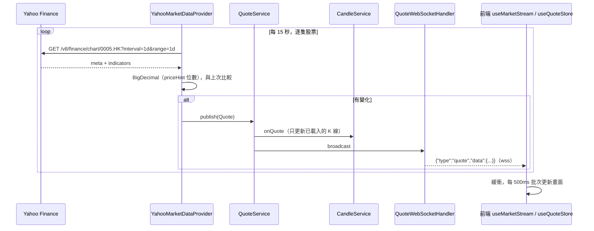

### 6.2 登入後打開 AI 分析師

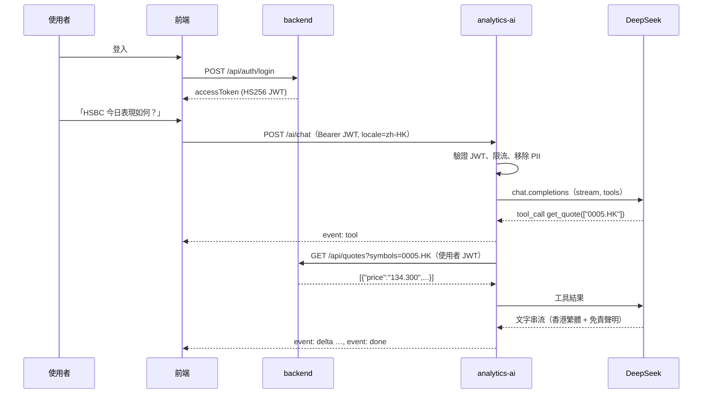

### 6.3 新聞擷取

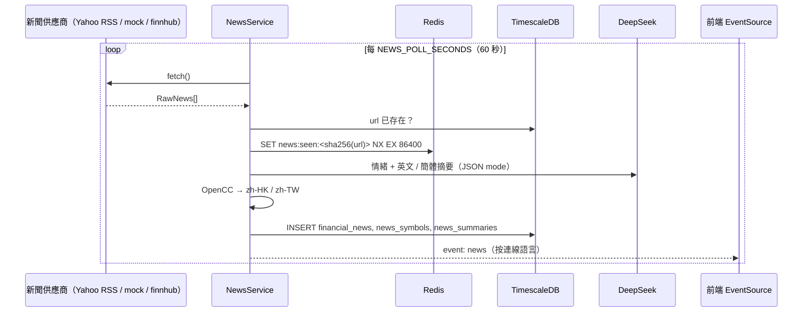

---

---

## 7. API 規格

所有路徑經 nginx 同源存取：`https://localhost:60003` 或 `https://stock.jackstudio.app`。金額欄位一律為字串。請求可帶 `Accept-Language`（`zh-HK` / `zh-TW` / `zh-CN` / `en-US`），影響公司名稱及新聞摘要語言。

### 7.1 backend（Spring Boot）

| 方法 | 路徑 | 認證 | 說明 |
|------|------|------|------|
| POST | `/api/auth/register` | — | `{email, password, displayName?, locale?}` → `201 {accessToken, expiresAt, user}` |
| POST | `/api/auth/login` | — | `{email, password}` → `{accessToken, expiresAt, user}` |
| GET / PATCH | `/api/me` | JWT | 個人資料；PATCH `{displayName?, preferredLocale?, colorScheme?}` |
| GET | `/api/instruments[?marquee=true]` | — | 商品清單（名稱按語言） |
| GET | `/api/instruments/{symbol}` | — | 單一商品；不存在 → `404 INSTRUMENT_NOT_FOUND` |
| GET | `/api/instruments/search?q=` | — | 代號 / 四語名稱搜尋，最多 20 筆 |
| GET | `/api/quotes[?symbols=A,B]` | — | 最新報價（最多 100 隻；省略則全部） |
| GET | `/api/candles?symbol=&interval=1d&limit=300` | — | K 線，`interval` ∈ `1m 5m 15m 30m 1h 4h 1d 1w 1M`，`limit` 1–1000 |
| GET | `/api/market/status` | — | NASDAQ / NYSE / HKEX 交易時段 |
| GET | `/api/market/provider` | — | `{"provider":"yahoo"}` |
| GET / PUT | `/api/watchlist` | JWT | `{symbols:[...]}`（最多 200，未知代號自動略過） |
| GET / POST | `/api/portfolio/transactions` | JWT | 交易列表 / 新增 `{symbol, side, quantity, price, fee?, executedAt?}` |
| DELETE | `/api/portfolio/transactions/{id}` | JWT | `204`；導致超賣 → `422 INSUFFICIENT_POSITION` |
| GET | `/api/portfolio/positions` | JWT | `{positions:[...], summaries:[...]}` |
| GET | `/actuator/health` | — | 健康檢查 |

### 7.2 WebSocket `/ws/quotes`

```text
client → {"action":"subscribe","symbols":["AAPL","0005.HK"]}     ("*" = 全部，每連線最多 200 隻)
client → {"action":"unsubscribe","symbols":["AAPL"]}
client → {"action":"ping"}
server → {"type":"snapshot","data":[Quote...]}                    訂閱後立即回傳
server → {"type":"quote","data":Quote}
server → {"type":"pong","ts":1793088499000}
```

`Quote = {symbol, price, prevClose, open, high, low, change, changePercent, volume, lastSize, ts}`。只接受 `CORS_ALLOWED_ORIGINS` 內的 Origin；發送緩衝超過 512 KB 的慢連線會被斷開。

### 7.3 analytics-ai（FastAPI）

| 方法 | 路徑 | 認證 | 說明 |
|------|------|------|------|
| GET | `/ai/health` | — | `{status, llm, llmConfigured, newsProvider}` |
| GET | `/ai/news?symbol=&limit=30&locale=` | — | 新聞列表（最新在前，`limit` 1–100） |
| GET | `/ai/news/stream?locale=` | — | SSE：`event: news`；每 15 秒 `: keep-alive` |
| POST | `/ai/chat` | JWT | `{messages:[{role,content}], locale?}` → SSE：`tool` / `delta` / `done` / `error` |
| POST | `/ai/sentiment` | JWT | `{title, body?, symbols?}` → `{score, label, summaries}` |
| GET | `/ai/docs` | — | OpenAPI 文件 |

### 7.4 MCP server

```bash
cd analytics-ai
CYBERSTOCK_BACKEND_URL=https://localhost:60003 CYBERSTOCK_USER_TOKEN=<JWT> .venv/bin/python -m app.mcp_server
```

stdio 工具（全部唯讀）：`get_quote`、`get_candles`、`get_instrument`、`get_portfolio`。

---

## 8. 資料模型

Flyway migrations 位於 `backend/src/main/resources/db/migration/V1`–`V5`，由 backend 啟動時執行。`ticks`、`ohlcv_candles` 在 TimescaleDB 可用時建立為 hypertable。

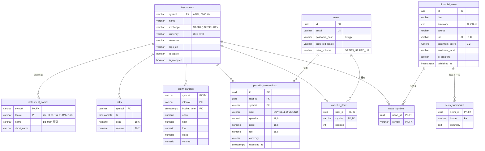

種子資料：13 隻股票（AAPL、NVDA、TSLA、MSFT、AMZN、GOOGL、META、JPM、0700.HK、9988.HK、3690.HK、0005.HK、1810.HK），各有四語名稱，其中 10 隻在走馬燈顯示。

> `ticks` 與 `ohlcv_candles` 已建表但目前未寫入；K 線由記憶體內的 `CandleService` 提供（見 [§13](#13-實作狀態與已知限制)）。

---

## 9. 安全與機密管理

### 9.1 機密檔案

| 檔案 | 內容 | 版本控制 |
|------|------|----------|
| `.env.example` | 變數名稱與說明，沒有真實值 | 提交 |
| `.env` | 以 dotenvx 公鑰加密的值（`encrypted:...`） | 可提交 |
| `.env.keys` | 解密私鑰 `DOTENV_PRIVATE_KEY` | **永不提交**（已列入 `.gitignore`） |
| `certs/server.pem`、`certs/server-key.pem` | nginx 自簽 TLS 憑證 | 不提交（已列入 `.gitignore`） |

服務啟動時由 `dotenvx run` 在記憶體中解密，再交給 `docker compose --env-file /dev/null`，Compose 不會直接讀取加密檔。

> ⚠️ 請備份 `.env.keys`（例如存入密碼管理器）。遺失後 `.env` 無法解密，只能重新 `init` 並重設所有值。

### 9.2 設定 API key（逐步說明）

以下指令都在**你自己的終端機**、專案根目錄執行。請不要把 key 貼在聊天、issue 或文件中。

**步驟 1：第一次使用時建立加密的 `.env`**（已建立過可跳過）

```bash
cd ~/github/stock
./scripts/secrets.sh init
```

這會由 `.env.example` 複製出 `.env`，自動產生 `POSTGRES_PASSWORD` 及 `JWT_SECRET`，並把所有值加密；私鑰寫入 `.env.keys`。如果 `.env` 已存在，指令會停止，不會覆蓋。

**步驟 2：設定 key**

```bash
./scripts/secrets.sh set DEEPSEEK_API_KEY
```

畫面顯示 `Value for DEEPSEEK_API_KEY:` 時貼上 key 並按 Enter。輸入時畫面不會顯示任何字元。成功會顯示：

```text
✓ DEEPSEEK_API_KEY stored encrypted in .env
```

**步驟 3：確認已加密**

```bash
./scripts/secrets.sh check
# ✓ .env is fully encrypted and .env.keys is ignored
```

**步驟 4：重新部署，讓服務讀取新值**

```bash
./scripts/deploy.sh up --no-build
```

**步驟 5：驗證**

```bash
curl -k https://localhost:60003/ai/health
# 應看到 "llmConfigured":true
```

之後新擷取的新聞會有利好 / 利淡 / 中性標籤，登入後也可使用 AI 分析師。

**常用的 key 與設定：**

| 用途 | 指令 | 備註 |
|------|------|------|
| DeepSeek（AI 情緒、摘要、AI 分析師） | `./scripts/secrets.sh set DEEPSEEK_API_KEY` | 唯一需要的付費 key |
| 備用 LLM（DeepSeek 失敗時才用） | `set LLM_FALLBACK_API_KEY`、`set LLM_FALLBACK_BASE_URL https://…`、`set LLM_FALLBACK_MODEL <模型>` | 三個都要設定才會啟用 |
| Finnhub（可選，取代 Yahoo） | `set FINNHUB_API_KEY`，再 `set MARKET_DATA_PROVIDER finnhub` / `set NEWS_PROVIDER finnhub` | 免費方案通常只有美股 |
| 非機密設定 | `./scripts/secrets.sh set NEWS_POLL_SECONDS 30` | 可直接把值寫在指令後面 |

**`secrets.sh` 用法摘要：**

| 指令 | 作用 |
|------|------|
| `./scripts/secrets.sh init` | 建立加密 `.env` 及 `.env.keys` |
| `./scripts/secrets.sh set KEY` | 提示輸入（不顯示）並加密寫入；`KEY` 只能是大寫字母、數字、底線 |
| `./scripts/secrets.sh set KEY value` | 直接寫入；值會留在 shell history，**不要用於真正的機密** |
| `./scripts/secrets.sh check` | 檢查所有值都已加密、`.env.keys` 沒有被 git 追蹤 |

**伺服器 / CI：** 不要複製 `.env.keys`，改為設定環境變數 `DOTENV_PRIVATE_KEY=<.env.keys 內的值>`，`deploy.sh` 會自動使用。

### 9.3 安全措施

| 範圍 | 措施 |
|------|------|
| 傳輸 | 全站 HTTPS（Caddy Let's Encrypt → nginx TLS 1.2/1.3）；同一埠的 HTTP 請求回 301 轉 HTTPS；HSTS |
| 標頭 | CSP（`default-src 'self'`、`connect-src 'self' wss:`、`frame-ancestors 'none'`）、`X-Frame-Options DENY`、`nosniff`、Referrer-Policy、Permissions-Policy |
| 認證 | BCrypt（cost 12）；HS256 JWT（≥ 32 bytes 密鑰、驗證 issuer、預設 120 分鐘）；登入錯誤不透露帳號是否存在 |
| 授權 | 使用者資料查詢一律以 JWT `sub` 為條件；整合測試驗證其他使用者看不到 |
| 金鑰 | 只存在後端容器；前端禁止用 `VITE_*` 傳遞金鑰；Finnhub key 用 header 傳送；日誌遮罩 `sk-…` 及 Bearer token |
| 輸入 | Bean Validation、JPA / psycopg 參數化查詢、搜尋字串長度限制、RSS 以 `defusedxml` 解析 |
| AI | 移除 PII、丟棄客戶端 system 訊息、工具唯讀並驗證參數、每使用者限流 |
| 網絡 | 資料庫與 Redis 在 `internal` 網絡（無對外連線）；只有 `cyberstock-web` 對外開放 60003 |
| 容器 | 全部以非 root 使用者執行；設定健康檢查 |

---

## 10. 部署（Docker + HTTPS + Caddy）

### 10.1 部署拓撲

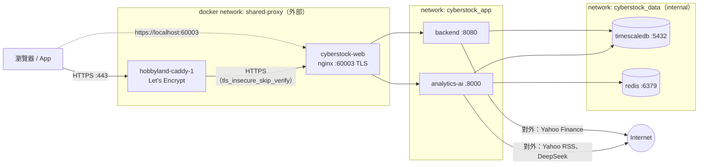

| 服務 | 容器 | 對外埠 | 健康檢查 |
|------|------|--------|----------|
| web | `cyberstock-web` | `60003`（HTTPS） | `http://127.0.0.1:8081/healthz`（容器內部） |
| backend | `cyberstock-backend-1` | — | `/actuator/health/readiness` |
| analytics-ai | `cyberstock-analytics-ai-1` | — | `/ai/health` |
| timescaledb | `cyberstock-timescaledb-1` | — | `pg_isready` |
| redis | `cyberstock-redis-1` | — | `redis-cli ping` |

Port 選擇：hk-weather 用 59001、bill-tracker 用 60001，CyberStock 用 **60003**（TCP 埠最大為 65535）。公開 80 / 443 由 hobbyland 的 Caddy 擁有。

### 10.2 部署流程

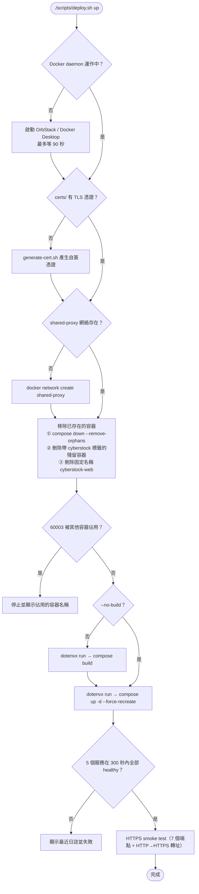

- `up` **一定會先移除已存在的 CyberStock 容器**，避免舊容器繼續提供舊映像或佔用 60003。
- 資料 volume（`cyberstock_pgdata`、`cyberstock_redisdata`）**不會**被刪除。
- `./scripts/deploy.sh down` 使用同一套移除邏輯。

### 10.3 公開 HTTPS（共用 Caddy）

1. 把 `deploy/Caddyfile.snippet` 的內容加入 `~/github/hobbyland/Caddyfile`：
   ```caddyfile
   stock.jackstudio.app {
       reverse_proxy https://cyberstock-web:60003 {
           transport http {
               tls_insecure_skip_verify
           }
           flush_interval -1
       }
   }
   ```
   `flush_interval -1` 讓 WebSocket 及 SSE 不被緩衝；這個站點刻意不加 `encode`，避免壓縮延遲 SSE 事件。
2. 重新載入 Caddy：`docker exec hobbyland-caddy-1 caddy reload --config /etc/caddy/Caddyfile`
3. 把 `stock.jackstudio.app` 的 DNS A / AAAA 記錄指向本機；Caddy 會自動申請 Let's Encrypt 憑證並把 HTTP 轉 HTTPS。
4. 確認 `CORS_ALLOWED_ORIGINS` 包含 `https://stock.jackstudio.app`（預設已包含）。

> `stock.jackstudio.app` 是暫定網域，可在 snippet、`DOMAIN` 及 `CORS_ALLOWED_ORIGINS` 中更改。

### 10.4 新聞更新與維護

**一般情況不需要任何操作。** AI 服務每 `NEWS_POLL_SECONDS`（預設 60 秒）向 Yahoo Finance 擷取新文章，自動存入資料庫並即時推送到 app，新聞頁會自動出現新文章，無需重新整理。已存在的文章（按網址判斷）會略過，不會重複。

| 需要 | 做法 |
|------|------|
| **立即擷取一次** | `docker restart cyberstock-analytics-ai-1`（服務啟動時會馬上擷取），然後重新整理瀏覽器 |
| **調整擷取頻率**（例如 30 秒） | `./scripts/secrets.sh set NEWS_POLL_SECONDS 30` → `./scripts/deploy.sh up --no-build`。最少 5 秒；每次會對 13 隻股票各發 1 個請求，建議 ≥ 30 秒以免被 Yahoo 限流 |
| **確認有新文章** | `curl -sk "https://localhost:60003/ai/news?limit=5"`，或 `docker logs --tail 20 cyberstock-analytics-ai-1 \| grep -i news`（有新文章時會出現 `Ingested N news items`） |
| **查看某隻股票的新聞** | `curl -sk "https://localhost:60003/ai/news?symbol=0005.HK&limit=5"` |
| **讓舊文章也有 AI 情緒** | 文章只在第一次擷取時分析；設定 DeepSeek key 前已存入的文章會保持「未分析」。如需重新分析，可刪除未分析的文章，下次擷取時會重新存入並分析（只會影響仍在 RSS 中、3 天內的文章）：<br/>`docker exec cyberstock-timescaledb-1 sh -c 'psql -U "$POSTGRES_USER" -d "$POSTGRES_DB" -c "DELETE FROM financial_news WHERE sentiment_label = '"'"'UNANALYZED'"'"'"'` |
| **清除模擬新聞**（由 mock 切換到 yahoo 之後） | `docker exec cyberstock-timescaledb-1 sh -c 'psql -U "$POSTGRES_USER" -d "$POSTGRES_DB" -c "DELETE FROM financial_news WHERE url LIKE '"'"'https://mock.cyberstock.local/%'"'"'"'` |
| **切換新聞來源** | `./scripts/secrets.sh set NEWS_PROVIDER yahoo`（或 `mock` / `finnhub`）→ `./scripts/deploy.sh up --no-build` |

**目前限制：**

- 只有種子資料中的 13 隻股票有新聞，清單固定在 `analytics-ai/app/news/providers.py`（`US_SYMBOLS`、`HK_SYMBOLS`）。要新增股票，需同時加入該清單及資料庫 `instruments` / `instrument_names`（Flyway migration）。
- 目前沒有手動新增或編輯文章的畫面或 API。
- 新聞標題及原文描述保持原文（主要為英文）；AI 摘要在設定 DeepSeek key 後才會提供四種語言。

### 10.5 其他維運指令

| 指令 | 用途 |
|------|------|
| `./scripts/deploy.sh status` | 各服務狀態 |
| `./scripts/deploy.sh logs backend` | 追蹤某服務日誌 |
| `./scripts/deploy.sh smoke` | 只執行 smoke test |
| `./scripts/deploy.sh down` | 停止並移除容器（保留資料） |
| `docker volume rm cyberstock_pgdata cyberstock_redisdata` | **刪除所有資料**（需先 `down`，無法復原） |

---

## 11. 建置、測試與手機 App

### 11.1 `scripts/build.sh`

| 指令 | 執行內容 |
|------|----------|
| `./scripts/build.sh` | frontend → backend → ai → images |
| `./scripts/build.sh frontend` | `npm ci`、`i18n:check`、`vitest`、`vue-tsc` + `vite build` |
| `./scripts/build.sh backend` | `mvn verify`（單元 + Testcontainers 整合測試，需要 Docker） |
| `./scripts/build.sh ai` | 建立 `.venv`、`pip install -e .[dev]`、`ruff check`、`pytest` |
| `./scripts/build.sh images` | `docker compose build`（建置時不需要任何機密） |
| `./scripts/build.sh mobile https://stock.jackstudio.app` | 以 `VITE_API_BASE_URL` 建置前端並 `npx cap sync`（原生 App 必須用 HTTPS） |

選項：`SKIP_TESTS=1` 跳過測試；`SKIP_IT=1` 跳過後端整合測試。腳本會自動從 `docker context` 取得 `DOCKER_HOST`（OrbStack 需要）。

### 11.2 測試

| 元件 | 測試 | 數量 | 重點 |
|------|------|------|------|
| backend | `PortfolioCalculatorTest` | 7 | 平均成本、部分沽出、全數沽出無餘數、股息、多幣別、超賣、時間排序、`0.1+0.2` 精度 |
| backend | `MarketUnitTest` | 10 | K 線分桶（交易所時區）、夏令時間、港股午休、K 線合併、`Accept-Language` 對應 |
| backend | `YahooMarketDataProviderTest` | 4 | Yahoo 回應解析、float32 誤差還原、1h→4h 合併、日線對齊交易所午夜 |
| backend | `ApiIntegrationTest` | 4 | 真實 TimescaleDB：四語名稱、跨繁簡搜尋、字串金額、JWT、超賣 422、使用者隔離、自選股、WebSocket |
| analytics-ai | `test_analysis.py` | 7 | Decimal 分數、標籤、一次呼叫產生四語、DeepSeek 失敗 fallback、地區用語 |
| analytics-ai | `test_api.py` | 7 | 新聞去重、JWT 驗證、工具迴圈、PII 移除、未設定 key |
| analytics-ai | `test_deepseek_provider.py` | 2 | 真實 OpenAI SDK 對 stub DeepSeek：JSON mode、串流工具呼叫拼接 |
| analytics-ai | `test_yahoo_news.py` | 4 | RSS 解析、過濾舊 / 非 HTTPS 文章、XML 實體攻擊、跨股票合併 |
| frontend | `core.spec.ts` | 11 | 語言偵測、Decimal 格式化、500ms 節流、SSE 解析、重連退避、`t()` key 覆蓋 |

合計 56 個測試，全部通過；另有 `npm run i18n:check` 檢查四語系 139 個 key。測試不連接 Yahoo 或 DeepSeek（使用錄製的回應及 stub）。

### 11.3 手機 App（Capacitor）

```bash
./scripts/build.sh mobile https://stock.jackstudio.app
cd frontend && npx cap open ios        # Xcode
cd frontend && npx cap open android    # Android Studio
```

- App ID：`com.cyberstock.pulse`；原生專案在 `frontend/ios/`、`frontend/android/`。
- iOS：`Info.plist` 已設定 `CFBundleLocalizations`（en、zh-Hant-HK、zh-Hant-TW、zh-Hans）。
- Android：`locales_config.xml` 支援 Android 13+ 應用程式個別語言；`values-zh-rHK` / `rTW` / `rCN` 在地化字串；硬件返回鍵會返回上一頁或退出。
- 原生 App 的來源是 `capacitor://localhost`（iOS）/ `https://localhost`（Android），已包含在 `CORS_ALLOWED_ORIGINS` 預設值中。
- 原生 App 不信任自簽憑證，所以 `VITE_API_BASE_URL` 必須是有正式憑證的網址（Caddy 提供的公開網域）。

---

## 12. 設定（環境變數）

全部存放在加密的 `.env`，以 `./scripts/secrets.sh set KEY` 修改，修改後執行 `./scripts/deploy.sh up --no-build`。

| 變數 | 預設 | 說明 |
|------|------|------|
| `POSTGRES_DB` / `POSTGRES_USER` | `cyberstock` | 資料庫名稱 / 使用者 |
| `POSTGRES_PASSWORD` | `init` 時自動產生 | **必填** |
| `JWT_SECRET` | `init` 時自動產生 | **必填**，≥ 32 bytes，backend 與 analytics-ai 共用 |
| `JWT_TTL_MINUTES` | `120` | Token 有效期 |
| `CORS_ALLOWED_ORIGINS` | `https://localhost:60003,https://stock.jackstudio.app,http://localhost:5173,capacitor://localhost,https://localhost` | 允許的瀏覽器 / App 來源 |
| `MARKET_DATA_PROVIDER` | `yahoo` | `yahoo` \| `mock` \| `finnhub` |
| `YAHOO_POLL_SECONDS` | `15` | 行情輪詢間隔（最少 5） |
| `FINNHUB_API_KEY` / `FINNHUB_POLL_SECONDS` | 空 / `15` | 只在選用 Finnhub 時需要 |
| `NEWS_PROVIDER` | `yahoo` | `yahoo` \| `mock` \| `finnhub` |
| `NEWS_POLL_SECONDS` | `60` | 新聞擷取間隔（最少 5） |
| `DEEPSEEK_API_KEY` | 空 | AI 功能需要；空白時新聞標記「未分析」，AI 分析師停用 |
| `DEEPSEEK_BASE_URL` | `https://api.deepseek.com` | |
| `DEEPSEEK_MODEL_FAST` | `deepseek-chat` | 情緒 / 摘要模型 |
| `DEEPSEEK_MODEL_CHAT` | `deepseek-chat` | AI 分析師模型（必須支援工具呼叫） |
| `LLM_TIMEOUT_SECONDS` / `LLM_MAX_RETRIES` | `30` / `2` | |
| `LLM_FALLBACK_BASE_URL` / `_API_KEY` / `_MODEL` | 空 | 備用 OpenAI 相容 LLM，三個都設定才啟用 |
| `WEB_PORT` | `60003` | 對外 HTTPS 埠 |
| `DOMAIN` | `stock.jackstudio.app` | 公開網域（部署訊息顯示用） |
| `IMAGE_TAG` | `latest` | Docker 映像標籤 |
| `EXTERNAL_PROXY_NET` | `shared-proxy` | 與 Caddy 共用的 Docker 網絡 |

---

## 13. 實作狀態與已知限制

| Phase | 內容 | 狀態 |
|-------|------|------|
| 0 | Monorepo、Docker Compose、加密 `.env`、建置 / 部署腳本 | ✅ |
| 1 | Cyberpunk 設計系統、響應式外殼、四語系、PWA | ✅ |
| 2 | Flyway schema、商品主檔、四語名稱、跨繁簡搜尋、交易時段 | ✅ |
| 3 | 實時行情（Yahoo / mock / Finnhub）、WebSocket、走馬燈、Logo、節流、重連 | ✅ |
| 4 | K 線（真實 Yahoo 歷史 + 實時更新） | ✅ |
| 5 | 真實新聞（Yahoo RSS）、DeepSeek 情緒及四語摘要、SSE、突發彈窗 | ✅ |
| 6 | JWT 認證、投資組合、自選股同步 | ✅ |
| 7 | AI 分析師（DeepSeek 工具呼叫 + SSE）、MCP server | ✅ |
| 8 | Capacitor iOS / Android 專案與在地化 | ✅ 已產生；尚未在實機 / 模擬器測試 |
| 9 | HTTPS（nginx + Caddy）；壓測、監控、Rust gateway | 🟡 HTTPS 完成；其餘未開始 |

**已知限制：**

- **Yahoo Finance 是非官方端點**：沒有服務保證，可能無預警改變、限流或封鎖；條款只允許個人使用，不可向其他使用者公開展示。港股報價約延遲 15 分鐘；報價為輪詢（15 秒），不是逐筆。
- 只有 13 隻種子股票；新增股票需要 migration，並修改新聞清單（[§10.4](#104-新聞更新與維護)）。
- 未處理交易所公眾假期；投資組合不做匯率換算。
- K 線在 backend 記憶體中，重啟後重新從 Yahoo 取得；`ticks` / `ohlcv_candles` 表尚未寫入。
- 限流在單一程序記憶體內；擴展到多個副本時需改用 Redis。
- 股票 Logo 為自動產生的霓虹字母圖示，正式品牌 Logo 需向授權供應商取得。
- JWT 只有 access token（無 refresh token）；Web 存於 `localStorage`，App 存於 Capacitor Preferences。
- DeepSeek 在中國境內處理資料；AI 分析師會傳送使用者的持倉摘要（不含電郵、姓名）。

---

## 14. 變更紀錄

| 日期 | 變更 | 影響 |
|------|------|------|
| 2026-10-27 | 首次建置：frontend、backend、analytics-ai、Docker Compose、加密 `.env`（dotenvx）、`build.sh` / `deploy.sh` / `secrets.sh` | — |
| 2026-10-27 | `secrets.sh` 改為非互動模式（`--no-armor --no-native --no-1password --no-bitwarden`），私鑰只存於本機 `.env.keys` | `init` / `set` 不再停在 dotenvx 的選單 |
| 2026-10-27 | 改用 **HTTPS**：nginx 在 `60003` 以自簽憑證提供 TLS；加入 `scripts/generate-cert.sh`；`cyberstock-web` 加入 `shared-proxy` 網絡；`deploy/Caddyfile.snippet` 供 hobbyland Caddy 使用 | 網址由 `http://localhost:8088` 改為 `https://localhost:60003` |
| 2026-10-27 | 埠號定為 **60003**（要求的 70003 超過 TCP 上限 65535） | `WEB_PORT=60003` |
| 2026-10-27 | `deploy.sh up` **先移除已存在的容器**（compose down、標籤殘留容器、`cyberstock-web`），並檢查 60003 是否被其他容器佔用 | 重複部署不會留下舊容器；資料 volume 保留 |
| 2026-10-28 | 新增 **Yahoo Finance 行情供應商**（免 API key），取代模擬價格；成為 Docker 預設 | 例如 HSBC 由模擬的 95 變為真實的 134.30 |
| 2026-10-28 | K 線改用 **真實 Yahoo 歷史**：懶載入、每 5 分鐘更新、重新分桶到 app 週期；取不到時不編造價格 | 圖表顯示真實走勢 |
| 2026-10-28 | 前端數據來源提示：mock 顯示「模擬數據」，yahoo 顯示「可能有延遲」 | 新增 i18n key `app.delayedYahoo` |
| 2026-10-28 | `FINNHUB_POLL_SECONDS` 預設改為 15 秒並傳入容器（原本 5 秒會超過免費方案 60 次 / 分鐘） | Finnhub 改為可選 |
| 2026-10-28 | 新增 **Yahoo Finance RSS 新聞供應商**（免 API key），成為 Docker 預設；以 `defusedxml` 解析；跨股票合併；「突發」只限 2 小時內的文章 | 新聞由模擬變為真實；已刪除資料庫中的 97 則模擬新聞 |
| 2026-10-28 | 文件整合為單一 `README.md`（程式規格、技術規格、圖表、API key 步驟、新聞維護） | 刪除 `PROGRAM_SPEC.md` |
| 2026-10-28 | **視覺升級**：開頁動畫（F-15）、漸變色及 3D 元素（F-16）、`v-tilt` 指令、新 i18n key `app.tapToSkip` | 新檔：`SplashScreen.vue`、`CyberBackdrop.vue`、`directives/tilt.ts` |
| 2026-10-28 | 手機版修正：個股標題不再被擠成直排；K 線週期按鈕排成一行；安全區域 padding 不再覆蓋頁面左右邊距 | 390px 闊螢幕截圖已驗證 |
